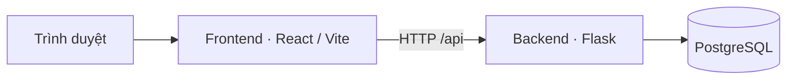

# PMS — Hệ thống quản lý khách sạn

PMS (Property Management System) là đồ án xây dựng hệ thống quản lý khách sạn theo mô hình SaaS. Repository này lưu mã nguồn backend, frontend và lịch sử bàn giao của nhóm qua Git/GitHub.

> **Cập nhật ngày 25/11/2026:** Repository đã có mã nguồn cho đặt phòng, giá và tồn phòng, OTA, tài chính, buồng phòng, kho, báo cáo và quản trị. Các hạng mục được tích hợp qua Pull Request; ứng dụng vẫn cần bổ sung các điểm kết nối, tài nguyên và migration còn thiếu trước khi chạy đầy đủ.

## Mục tiêu của hệ thống

Hệ thống hướng đến ba khu vực sử dụng:

| Khu vực | Mục tiêu |
| --- | --- |
| Website giới thiệu | Giới thiệu sản phẩm, gói dịch vụ và thông tin liên hệ. |
| Ứng dụng khách sạn | Quản lý phòng, đặt phòng, lưu trú, buồng phòng, thu chi, kho và báo cáo. |
| Quản trị hệ thống | Quản lý khách sạn, tài khoản, quyền truy cập và thuê bao dịch vụ. |

Kiến trúc tổng thể khi ghép đủ mã nguồn:



## Công nghệ sử dụng

Các phiên bản dưới đây được khai báo trong cấu hình hiện tại của repository.

| Thành phần | Công nghệ |
| --- | --- |
| Giao diện | React 19, JavaScript/JSX, React Router 7, CSS. |
| Công cụ frontend | Vite 8, Node.js từ 22.12.0, npm 11.16.0. |
| Backend | Python 3.14, Flask 3.1.3. |
| Truy cập dữ liệu | SQLAlchemy 2.0, Flask-SQLAlchemy, Psycopg 3. |
| Cơ sở dữ liệu và migration | PostgreSQL, Flask-Migrate, Alembic. |
| Kiểm thử và kiểm tra mã | Python unittest, Node.js test runner, Oxlint, Ruff. |
| Quản lý mã nguồn | Git, GitHub, nhánh theo hạng mục và Pull Request. |

## Cấu trúc repository

```text
pms_project/
├── backend/
│   ├── common/               # Tiện ích HTTP và định dạng dữ liệu dùng chung
│   ├── pms_api/              # Flask, phân quyền và các module nghiệp vụ
│   ├── tests/                # Kiểm thử và dữ liệu mẫu cho kiểm thử
│   ├── app.py                # Điểm khởi chạy backend
│   ├── manage.py             # Lệnh quản lý ứng dụng Flask
│   ├── requirements.txt      # Phụ thuộc backend
│   └── .env.example          # Mẫu biến môi trường
├── frontend/
│   ├── public/               # Tài nguyên tĩnh và trang 404
│   ├── src/
│   │   ├── app/              # Cấu hình điều hướng và kiểm thử route
│   │   ├── assets/           # Tài nguyên giao diện
│   │   ├── apps/             # Ứng dụng khách sạn, quản trị và marketing
│   │   └── shared/           # Component, định dạng dữ liệu, đa ngôn ngữ và biểu mẫu
│   ├── package.json          # Phụ thuộc và các lệnh frontend
│   └── vite.config.js        # Cấu hình Vite và proxy API
├── start_backend.bat         # Công cụ khởi chạy backend trên Windows
├── start_frontend.bat        # Công cụ khởi chạy frontend trên Windows
└── README.md
```

## Thành viên

Tên thành viên được ghi theo thông tin tác giả trong lịch sử Git.

| Thành viên | Phạm vi tham gia |
| --- | --- |
| Le Tran Xuan Loc (Lộc) | Backend và frontend theo các hạng mục được phân công. |
| Dinh Y Thuc (Thức) | Backend và frontend theo các hạng mục được phân công. |

Chi tiết đóng góp có thể xem tại [lịch sử commit](https://github.com/dinhythuc240594/pms_project/commits/main/) và [các Pull Request đã merge](https://github.com/dinhythuc240594/pms_project/pulls?q=is%3Apr+is%3Amerged).

## Phạm vi mã nguồn hiện có

| Hạng mục | Các thành phần đã có mã nguồn |
| --- | --- |
| Nền tảng | Cấu hình Flask/React, đăng nhập, phân quyền, workspace, tiện ích HTTP, nhập ngày và đa ngôn ngữ. |
| Phòng và đặt phòng | Danh mục phòng, đặt phòng, lưu trú, chi tiết booking, thanh toán và thay đổi kỳ ở. |
| Giá và tồn phòng | Giá theo đêm, ma trận giá, lịch ARI, quy tắc giá và dữ liệu phục vụ báo cáo. |
| Kênh OTA | Kết nối Channex, quản lý credential, mapping, hàng đợi đồng bộ, onboarding, lịch sử và giao diện xử lý ngoại lệ. |
| Tài chính và đối soát | Bán hàng POS, sổ quỹ, hoa hồng, báo cáo kinh doanh, đối soát và chốt ngày. |
| Buồng phòng | Danh sách công việc, lịch sử, nhân viên, ca làm, phân công và kế hoạch dọn tự động. |
| Kho | Nhập, xuất, chuyển, kiểm kê, tồn kho và thiết lập danh mục kho, hàng hóa, vật tư, nhà cung cấp. |
| Quản trị | Các thành phần quản lý khách sạn, người dùng, thuê bao, tính năng và hỗ trợ OTA. |

Bảng trên mô tả phạm vi mã nguồn, chưa xác nhận các chức năng đã chạy hoàn chỉnh. Mã trên nhánh bàn giao được đưa vào `main` sau khi Pull Request được kiểm tra và merge.

### Bàn giao ngày 22/11/2026

- Bổ sung [InventorySettings.jsx](frontend/src/apps/pms/inventory/pages/InventorySettings.jsx) cùng [CSS](frontend/src/apps/pms/inventory/pages/InventorySettings.css), lấy nguyên nội dung từ bản `pms-system` hiện tại.
- Cập nhật README theo tiến độ tích hợp, cấu hình thực tế và quy trình một nhánh mỗi ngày.
- File `backend/pms_api/channels/exceptions_application.py` trong danh sách phân công không có ở nguồn hiện tại nên được bỏ qua; không lấy bù từ bản snapshot của workflow.

### Chuẩn bị các gói 24–27/11/2026

Bốn gói được chuẩn bị cùng đợt vào ngày 24/11/2026 trên một nhánh chung; ngày trong bảng là nhãn phân công của workflow, không phải ngày thực hiện commit.

| Gói Lộc | File có trong nguồn | Nội dung chính |
| --- | --- | --- |
| 24/11 | 5/6 | Quản lý tính năng và giao diện thanh toán của chủ khách sạn. |
| 25/11 | 9/10 | Quản trị Channex, danh mục mapping và thao tác OTA của khách sạn. |
| 26/11 | 8/10 | Airbnb, chọn nguồn kết nối và giao diện kênh OTA. |
| 27/11 | 9/10 | Thông báo, bố cục quản trị và chỉ báo vận hành. |

Tổng cộng 31 file ứng dụng được lấy từ `pms-system`. Bỏ qua bốn file chưa có trong `backend/pms_api/admin/`: `features_application.py`, `channex_application.py`, `channex_channels_application.py`, `channex_insights_application.py`; cùng `frontend/src/apps/manager/mockData.js`. Không lấy bù từ snapshot workflow.

### Chuẩn bị các gói 28–30/11/2026

Ba gói tiếp theo được chuẩn bị vào ngày 25/11/2026 trên một nhánh chung. Ngày của gói là nhãn phân công; commit giữ ngày thực hiện thật.

| Gói Lộc | File có trong nguồn | Nội dung chính |
| --- | --- | --- |
| 28/11 | 14/15 | Giá gói dịch vụ, thuê bao, tính năng, hồ sơ và hỗ trợ OTA quản trị. |
| 29/11 | 14/15 | Đối soát, khóa kỳ tài chính và biểu mẫu quản lý thuê bao. |
| 30/11 | 7/8 | Thay đổi kỳ ở, hoa hồng và biểu mẫu kênh Channex/Airbnb. |

35 file ứng dụng được lấy nguyên nội dung từ `pms-system`. Bỏ qua ba file chưa có trong nguồn: `backend/pms_api/saas_billing/application.py`, `backend/pms_api/reconciliation/application.py` và `backend/pms_api/finance/commissions_application.py`.

## Thiết lập và kiểm tra

### Lấy mã nguồn

```powershell
git clone https://github.com/dinhythuc240594/pms_project.git
cd pms_project
```

### Điều kiện để chạy ứng dụng

Chuẩn bị Python 3.14, Node.js từ 22.12.0, npm và PostgreSQL. Mẫu cấu hình backend nằm tại [backend/.env.example](backend/.env.example); thông tin kết nối database được cấu hình ở backend. Giữ mật khẩu và khóa dịch vụ trong môi trường local hoặc môi trường triển khai.

Một số điểm còn thiếu đã được xác định trong bản hiện tại:

- Backend: file đăng ký route `pms_api/admin/urls.py` đang được tham chiếu nhưng chưa có. Thư mục `backend/migrations/` cũng chưa được bàn giao.
- Frontend: cấu hình Vite tham chiếu `frontend/scripts/bundle-manifest.mjs` chưa có; một số layout và trang quản trị được khai báo trong điều hướng vẫn cần bổ sung.
- Công cụ Windows: `start_backend.bat` cần `backend/scripts/local_postgres.py`; helper và tài liệu `backend/README.md` mà file này tham chiếu chưa có trong repo.
- Docker: `backend/Dockerfile` cài dependency với `--require-hashes`, trong khi các file requirements hiện chỉ có phiên bản. Cần bổ sung hash và migration trước khi dùng quy trình Docker này.

Việc cài thư viện chưa đủ để khắc phục các file còn thiếu ở trên. Các lệnh sau áp dụng khi đã ghép đủ mã nguồn, cấu hình môi trường và chuẩn bị database phù hợp:

| Thư mục thực hiện | Lệnh | Mục đích |
| --- | --- | --- |
| `frontend/` | `npm ci` | Cài phụ thuộc theo lockfile. |
| `frontend/` | `npm run dev` | Chạy giao diện trong môi trường phát triển. |
| `frontend/` | `npm test` | Chạy bộ kiểm thử frontend. |
| `frontend/` | `npm run lint` | Kiểm tra mã frontend. |
| `frontend/` | `npm run build` | Tạo bản build frontend. |
| `backend/` | `python -m venv .venv` | Tạo môi trường riêng bằng Python 3.14. |
| `backend/` | `.\.venv\Scripts\python.exe -m pip install -r requirements.txt` | Cài phụ thuộc backend vào môi trường riêng trên Windows. |
| `backend/` | `.\.venv\Scripts\python.exe app.py` | Chạy backend sau khi hoàn tất mã nguồn, cấu hình database và migration. |
| `backend/` | `.\.venv\Scripts\python.exe -m unittest discover -s tests` | Chạy kiểm thử; các bài tích hợp cần database kiểm thử và fixture tương ứng. |

Các lệnh Python trong bảng dùng PowerShell trên Windows; `python` phải trỏ đến Python 3.14 khi tạo môi trường. Cấu hình frontend khai báo npm 11.16.0 và có lockfile cho `npm ci`.

Frontend proxy cả `/api` và `/p` đến backend tại `http://127.0.0.1:5000`. Hai file `start_backend.bat` và `start_frontend.bat` hỗ trợ chạy trên Windows khi đã hoàn tất thiết lập. Riêng `start_backend.bat` còn khởi động PostgreSQL local và chạy migration, nên cần đủ helper, schema và môi trường database trước khi sử dụng.

**Tình trạng kiểm chứng:** 31 file trong đợt 24–27/11 đã được đối chiếu SHA-256 với nguồn; kiểm tra cú pháp 11 file Python, kiểm tra tĩnh 15 file JavaScript/JSX và phân tích 5 file CSS đều đạt, không có cảnh báo. Mười bài kiểm thử Node độc lập trong `catalog.test.js`, `clientChannelOperations.test.js` và `operationsPresentation.test.js` đều qua. Chưa chạy test giao diện, test tích hợp PostgreSQL, toàn bộ ứng dụng hoặc bản build; kiểm tra tĩnh và các test độc lập không thay thế kiểm thử khi ghép đủ hệ thống.

**Kiểm tra đợt 28–30/11:** Đối chiếu SHA-256 của 35 file và kiểm tra cú pháp 12 file Python đều đạt. Kiểm tra tĩnh 19 file JavaScript/JSX không có lỗi, còn 3 cảnh báo nguồn tại `AdminFeatures.jsx` và `PlanPricingModal.jsx`; 4 file CSS phân tích thành công. 23 bài kiểm thử độc lập trong `saasBillingForm.test.js`, `subscriptionStatus.test.js`, `airbnbReturn.test.js` và `channelForms.test.js` đều qua. `planForm.test.js` chưa chạy vì thiếu `frontend/src/shared/config/featureVisibility.js`; các test giao diện, tích hợp PostgreSQL và bản build vẫn chưa được chạy.

## Quy trình làm việc

1. Cập nhật `main` trước khi bắt đầu hạng mục mới.
2. Ưu tiên một nhánh cho gói công việc mỗi ngày. Khi chuẩn bị nhiều gói trong cùng đợt, dùng một nhánh chung, ví dụ `loc/2026-11-24-27-handoff`.
3. Chia commit theo từng phần việc có ý nghĩa trên cùng nhánh. Giữ component, CSS và kiểm thử liên quan trong cùng nhóm; chỉ stage đúng các file đã kiểm tra.
4. Push nhánh và mở một Pull Request về `main`, ghi nội dung bàn giao, cách kiểm tra và phần phụ thuộc còn thiếu.
5. Kiểm tra, merge vào `main`, đồng bộ lại trên máy và cập nhật README khi tiến độ thay đổi.

Lịch sử commit và Pull Request được giữ để theo dõi từng lần bàn giao, nội dung thay đổi và thành viên thực hiện.
