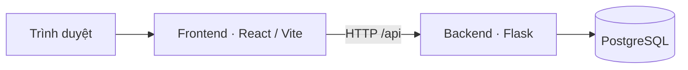

# LOHA PMS — Hệ thống quản lý khách sạn

LOHA PMS (Property Management System) là đồ án xây dựng hệ thống quản lý khách sạn theo mô hình SaaS. Repository này lưu mã nguồn backend, frontend và lịch sử bàn giao của nhóm qua Git/GitHub.

> **Trạng thái cập nhật ngày 09/11/2026:** Đang tích hợp mã nguồn theo từng hạng mục. Phần nền tảng và một số thành phần dùng chung đã được ghép vào `main`; ứng dụng cần thêm các module nghiệp vụ, tài nguyên và migration để chạy đầy đủ.

## Mục tiêu của hệ thống

Hệ thống hướng đến ba khu vực sử dụng:

| Khu vực | Mục tiêu |
| --- | --- |
| Website giới thiệu | Giới thiệu sản phẩm, gói dịch vụ và thông tin liên hệ. |
| Ứng dụng khách sạn | Quản lý phòng, đặt phòng, lưu trú, buồng phòng, thu chi, kho và báo cáo. |
| Quản trị hệ thống | Quản lý khách sạn, tài khoản, quyền truy cập và thuê bao dịch vụ. |

Kiến trúc tổng thể khi ghép đủ mã nguồn:



## Công nghệ sử dụng

Các phiên bản dưới đây được khai báo trong cấu hình hiện tại của repository.

| Thành phần | Công nghệ |
| --- | --- |
| Giao diện | React 19, JavaScript/JSX, React Router 7, CSS. |
| Công cụ frontend | Vite 8, Node.js từ 22.12.0, npm 11.16.0. |
| Backend | Python 3.14, Flask 3.1.3. |
| Truy cập dữ liệu | SQLAlchemy 2.0, Flask-SQLAlchemy, Psycopg 3. |
| Cơ sở dữ liệu và migration | PostgreSQL, Flask-Migrate, Alembic. |
| Kiểm thử và kiểm tra mã | Python unittest, Node.js test runner, Oxlint, Ruff. |
| Quản lý mã nguồn | Git, GitHub, nhánh theo hạng mục và Pull Request. |

## Cấu trúc repository

```text
pms_project/
├── backend/
│   ├── common/               # Tiện ích HTTP và định dạng dữ liệu dùng chung
│   ├── pms_api/              # Khởi tạo ứng dụng, cấu hình, health và workspace
│   ├── tests/                # Kiểm thử và dữ liệu mẫu cho kiểm thử
│   ├── app.py                # Điểm khởi chạy backend
│   ├── manage.py             # Lệnh quản lý ứng dụng Flask
│   ├── requirements.txt      # Phụ thuộc backend
│   └── .env.example          # Mẫu biến môi trường
├── frontend/
│   ├── public/               # Tài nguyên tĩnh và trang 404
│   ├── src/
│   │   ├── app/              # Cấu hình điều hướng và kiểm thử route
│   │   ├── assets/           # Tài nguyên giao diện
│   │   └── shared/components/ # Thành phần giao diện dùng chung
│   ├── package.json          # Phụ thuộc và các lệnh frontend
│   └── vite.config.js        # Cấu hình Vite và proxy API
├── start_backend.bat         # Công cụ khởi chạy backend trên Windows
├── start_frontend.bat        # Công cụ khởi chạy frontend trên Windows
└── README.md
```

## Thành viên

Tên thành viên được ghi theo thông tin tác giả trong lịch sử Git.

| Thành viên | Phạm vi tham gia |
| --- | --- |
| Le Tran Xuan Loc (Lộc) | Backend và frontend theo các hạng mục được phân công. |
| Dinh Y Thuc (Thức) | Backend và frontend theo các hạng mục được phân công. |

Chi tiết đóng góp có thể xem tại [lịch sử commit](https://github.com/dinhythuc240594/pms_project/commits/main/) và [các Pull Request đã merge](https://github.com/dinhythuc240594/pms_project/pulls?q=is%3Apr+is%3Amerged).

## Tiến độ bàn giao

| Mốc | Nội dung đã có trên `main` |
| --- | --- |
| 08/11/2026 | Cấu hình dự án; khởi tạo Flask và React; cấu hình môi trường, dependency, router, Docker và công cụ chạy trên Windows. Phần của Lộc gồm 22 file qua 8 commit. |
| 09/11/2026 | Tiện ích HTTP chung; bộ xử lý health/workspace; kiểm thử cấu hình và hợp đồng route; trang 404, tài nguyên, CSS và các component dùng chung. Phần của Lộc gồm 22 file qua 10 commit. |

Các thành phần frontend đã được bàn giao gồm kiểm soát truy cập, nhập ngày, nhận diện thương hiệu, màn hình chờ và chỉ báo hoạt động yêu cầu. Backend đã có các file kiểm thử HTTP, cấu hình, khởi tạo ứng dụng và an toàn thiết lập PostgreSQL local.

Đây là tiến độ tích hợp mã nguồn. Các chức năng nghiệp vụ trong mục tiêu hệ thống sẽ được bổ sung và kiểm chứng khi ghép đủ các phần phụ thuộc.

## Thiết lập và kiểm tra

### Lấy mã nguồn

```powershell
git clone https://github.com/dinhythuc240594/pms_project.git
cd pms_project
```

### Điều kiện để chạy ứng dụng

Chuẩn bị Python 3.14, Node.js từ 22.12.0, npm và PostgreSQL. Mẫu cấu hình backend nằm tại [backend/.env.example](backend/.env.example); thông tin kết nối database được cấu hình ở backend. Giữ mật khẩu và khóa dịch vụ trong môi trường local hoặc môi trường triển khai.

Bản hiện tại còn thiếu một số phần phụ thuộc:

- Backend: các module nghiệp vụ, thành phần còn lại của `common`, migration và script thiết lập PostgreSQL local.
- Frontend: các trang/layout, tiện ích dùng chung, tài nguyên kiểu chữ và `scripts/bundle-manifest.mjs` được tham chiếu trong cấu hình Vite.
- Cấu hình Docker yêu cầu hash của các gói Python, trong khi `requirements.txt` hiện chỉ có phiên bản; cần đồng bộ cấu hình dependency trước khi dùng Docker.

Sau khi ghép đầy đủ mã nguồn và cấu hình môi trường, các lệnh chính là:

| Thư mục thực hiện | Lệnh | Mục đích |
| --- | --- | --- |
| `frontend/` | `npm ci` | Cài phụ thuộc theo lockfile. |
| `frontend/` | `npm run dev` | Chạy giao diện trong môi trường phát triển. |
| `frontend/` | `npm test` | Chạy bộ kiểm thử frontend. |
| `frontend/` | `npm run lint` | Kiểm tra mã frontend. |
| `frontend/` | `npm run build` | Tạo bản build frontend. |
| `backend/` | `python -m pip install -r requirements.txt` | Cài phụ thuộc vào môi trường Python riêng của dự án. |
| `backend/` | `python app.py` | Chạy backend sau khi hoàn tất cấu hình database và migration. |
| `backend/` | `python -m unittest discover -s tests` | Chạy kiểm thử; một số bài kiểm tra cần các module và môi trường tương ứng. |

Frontend được cấu hình proxy đường dẫn `/api` đến backend tại `http://127.0.0.1:5000`. Hai file `start_backend.bat` và `start_frontend.bat` hỗ trợ thao tác chạy trên Windows sau khi đã hoàn tất thiết lập.

**Tình trạng kiểm chứng:** Các file bàn giao đã được đối chiếu với nguồn và kiểm tra cú pháp, định dạng dữ liệu. Việc chạy đầy đủ ứng dụng, toàn bộ bộ kiểm thử và bản build sẽ được kiểm chứng sau khi bổ sung các phần phụ thuộc còn thiếu.

## Quy trình làm việc

1. Cập nhật `main` trước khi bắt đầu hạng mục mới.
2. Tạo nhánh theo người phụ trách, ngày và nội dung, ví dụ `loc/2026-11-09-frontend-date-input`.
3. Giữ file component, CSS và kiểm thử liên quan trong cùng hạng mục; kiểm tra đúng các file trước khi commit.
4. Push nhánh và mở Pull Request về nhánh phù hợp. Với các nhánh nối tiếp, nhánh tổng hợp chứa đầy đủ các commit trước đó.
5. Kiểm tra, merge vào `main`, đồng bộ lại trên máy và cập nhật README khi tiến độ thay đổi.

Lịch sử commit và Pull Request được giữ để theo dõi từng lần bàn giao, nội dung thay đổi và thành viên thực hiện.
