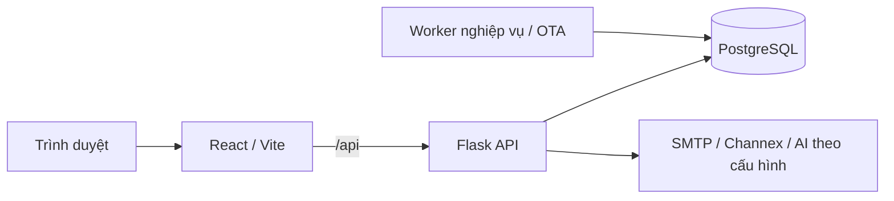

# PMS — Hệ thống quản lý khách sạn

PMS (Property Management System) là đồ án xây dựng hệ thống quản lý khách sạn theo mô hình SaaS. Repository này lưu mã nguồn backend, frontend và lịch sử bàn giao của nhóm qua Git/GitHub.

> **Cập nhật 27/11/2026:** Đã tích hợp nguồn hiện tại từ `pms-system`, bổ sung các phần trước đây chưa có trong các gói workflow. Giữ lại chatbot và công cụ marketing AI của repo này. Kết quả kiểm tra và giới hạn được ghi ở cuối trang; cần nghiệm thu với PostgreSQL và dịch vụ thật trước khi vận hành.

## Phạm vi hệ thống

| Khu vực | Chức năng có trong mã nguồn |
| --- | --- |
| Website giới thiệu | Sản phẩm, gói dịch vụ, bài viết và biểu mẫu liên hệ qua backend SMTP. |
| Ứng dụng khách sạn | Phòng và hạng phòng, khách hàng, đặt phòng, lưu trú, giá và tồn phòng, buồng phòng, kho, thu chi, hoa hồng, báo cáo và Night Audit. |
| Kết nối OTA | Channex, ánh xạ phòng/gói giá, nhận booking, đồng bộ giá và tồn phòng, hàng đợi và xử lý ngoại lệ. |
| Quản trị hệ thống | Khách sạn, tài khoản, quyền, thuê bao, tính năng, thanh toán SaaS và nhật ký. |
| Công cụ AI | Chatbot hỗ trợ trong PMS và tạo trang marketing; cần cấu hình riêng ở backend và quyền sử dụng phù hợp. |



Đây là phạm vi triển khai trong mã nguồn, chưa phải xác nhận nghiệm thu tất cả nghiệp vụ hoặc tích hợp bên ngoài.

## Công nghệ và cấu trúc

| Thành phần | Công nghệ / yêu cầu khai báo |
| --- | --- |
| Frontend | React 19, React Router 7, Vite 8, JavaScript/JSX, CSS. |
| Công cụ frontend | Node.js từ 22.12.0; npm 11.16.0. CI khai báo Node 24.18.0. |
| Backend | Python 3.14, Flask, SQLAlchemy, Psycopg 3. |
| Dữ liệu | PostgreSQL, Flask-Migrate / Alembic; script phát triển local dùng PostgreSQL 18. |
| Kiểm tra | Python unittest, Node test runner, Ruff, Oxlint, kiểm tra i18n. |

```text
backend/       API, nghiệp vụ, migration, worker, script và kiểm thử
frontend/      Website giới thiệu, ứng dụng khách sạn, quản trị hệ thống
postman/       Hợp đồng, bộ request và kịch bản mô phỏng API
docs/          Kiến trúc, báo cáo nguồn, kế hoạch và hướng dẫn vận hành
tasks/         Ghi chú công việc được chuyển từ nguồn
submission/    Bản nháp hồ sơ nhật ký sử dụng AI
```

Tài liệu cũ được giữ nguyên bối cảnh và ngày ghi nhận; một số tài liệu vẫn dùng tên LOHA PMS hoặc thuộc học phần cũ. Không dùng chúng thay thông tin lớp, nhóm và giảng viên của Tiểu luận chuyên ngành hiện tại.

## Chạy trên máy phát triển

Cài Python 3.14, Node.js/npm theo yêu cầu ở trên và PostgreSQL. Xem [hướng dẫn backend](backend/README.md) trước khi thiết lập database. Các bước dưới đây dành cho **database local riêng**, cần kiểm tra cấu hình kết nối trước khi chạy migration hoặc seed.

Từ thư mục `backend`, trong PowerShell:

```powershell
py -3.14 -m venv .venv
.\.venv\Scripts\python.exe -m pip install -r requirements-installer.txt
.\.venv\Scripts\python.exe -m pip install -r requirements.txt
.\.venv\Scripts\python.exe scripts/local_postgres.py start
.\.venv\Scripts\python.exe manage.py db upgrade
.\.venv\Scripts\python.exe manage.py install-chatbot-schema
.\.venv\Scripts\python.exe manage.py install-marketing-schema
.\.venv\Scripts\python.exe manage.py db-check
# Chỉ chạy lần đầu với database pms_local trống:
.\.venv\Scripts\python.exe manage.py seed-local
.\.venv\Scripts\python.exe manage.py run --host 127.0.0.1 --port 5000
```

Script local tạo cluster riêng, mặc định tại `127.0.0.1:15432`, và tạo `.env` nếu chưa tồn tại. Nếu đã có `.env`, script giữ file đó: kiểm tra đúng database local trước khi tiếp tục. Với PostgreSQL tự cấu hình, dùng mẫu `backend/.env.example` và hướng dẫn backend. Không đưa `.env`, mật khẩu, khóa AI hay dữ liệu nghiệp vụ lên Git; không đặt bí mật trong biến frontend `VITE_`.

Chuỗi Alembic hiện có 50 revision, một head `0045_room_type_details` và không thiếu revision cha. Chatbot/marketing dùng hai lệnh cài schema riêng sau migration core, theo [hướng dẫn chatbot](backend/pms_api/chatbot/README.md) và [hướng dẫn marketing AI](backend/pms_api/marketing/README.md). Đợt cập nhật này chỉ kiểm tra đồ thị migration và sinh SQL offline; chưa áp dụng lên PostgreSQL thật.

Ở cửa sổ khác, từ thư mục `frontend`:

```powershell
npm ci --ignore-scripts --no-audit --no-fund
npm run dev
```

Mở địa chỉ Vite hiển thị, vào `/id/login` và dùng tài khoản do backend tạo. Vite chuyển `/api` về `http://127.0.0.1:5000`; bản triển khai cần cấu hình API/proxy riêng. Xem [hướng dẫn frontend](frontend/README.md) và [hợp đồng API](backend/API_CONTRACT.md).

Các worker buồng phòng/Channex chạy riêng theo tài liệu backend. SMTP và dịch vụ AI cần thông tin xác thực ở môi trường backend; bước thiết lập local không tự cấu hình các dịch vụ đó.

## Kiểm tra đợt đồng bộ 26–27/11/2026

| Nội dung | Kết quả thực hiện |
| --- | --- |
| Frontend | 704/704 kiểm thử đạt, không bỏ qua; build thành công. |
| Backend cô lập | 100/100 kiểm thử đạt, gồm các kiểm tra cục bộ, AI với provider mô phỏng và fixture schema. |
| Ruff backend | Không có lỗi. |
| Lint frontend | Không có lỗi, còn 47 cảnh báo. |
| i18n | Lệnh audit chạy thành công; còn 887 ứng viên chưa có trong catalog. |
| Build | Còn cảnh báo chunk lớn hơn 500 KB. |

Kiểm thử backend dùng môi trường cô lập, chặn kết nối ngoài và mô phỏng provider; không thay thế toàn bộ bộ kiểm thử PostgreSQL/CI. Chưa chạy database thật, migration/restore thật, SMTP, provider AI/Channex thật hoặc nghiệm thu trên trình duyệt. Các cảnh báo trên chưa được xử lý trong đợt đồng bộ này.

Các lệnh kiểm tra frontend từ thư mục `frontend`:

```powershell
npm test
npm run lint
npm run i18n:audit
npm run build
```

Kiểm thử backend có phần cần database dùng riêng cho testing; đọc [hướng dẫn kiểm thử backend](backend/README.md) và cấu hình của `backend/scripts/ci_database.py` trước khi chạy. Không trỏ bộ kiểm thử này vào database đang sử dụng.

## Nguồn cập nhật và lịch sử đóng góp

Đợt này so sánh 794 file hợp lệ ở `pms-system`, chép 619 file mới/thay đổi và ghép thủ công những điểm cần giữ tích hợp của repo đích. Giữ đủ 70 file chỉ có ở repo đích. File runtime, cache, cấu hình riêng, `.env` và đầu ra công cụ không được chuyển vào lịch sử cập nhật.

Thay đổi được chia thành 65 commit module trên nhánh `loc/2026-11-26-source-sync-ai-log`, kèm các commit tài liệu/hồ sơ riêng. Đây là lịch sử tích hợp mã sẵn có; số commit không đại diện số tính năng mới, ngày công hay tác giả của từng dòng. Xem [biên bản đồng bộ và kiểm chứng](docs/sync/SOURCE_SYNC_2026-11-27.md).

## Hồ sơ nhật ký sử dụng AI

Thư mục [submission/ai-usage-log](submission/ai-usage-log) chứa bản nháp PDF, nội dung Markdown, dữ liệu prompt, nhật ký hoạt động, mẫu bổ sung lịch sử và nội dung tham khảo cho ô nộp bài. Gói ZIP chỉ gồm hồ sơ nhật ký, dung lượng dưới 5 MB.

**Hồ sơ hiện có 36 lượt người dùng trong lịch sử chat đang thấy và 9 query artifact được ghi riêng. Đây là bản dự thảo toàn dự án, còn thiếu các phiên AI khác và lịch sử thành viên khác; chưa ký xác nhận, chưa nộp lên cổng trường.** Sinh viên cần bổ sung lịch sử, xác nhận thông tin học phần và tự rà soát đầu ra trước khi nộp. Xem [nhật ký](submission/ai-usage-log/ai_usage_log.md) và [mẫu bổ sung](submission/ai-usage-log/missing_history_template.csv).
